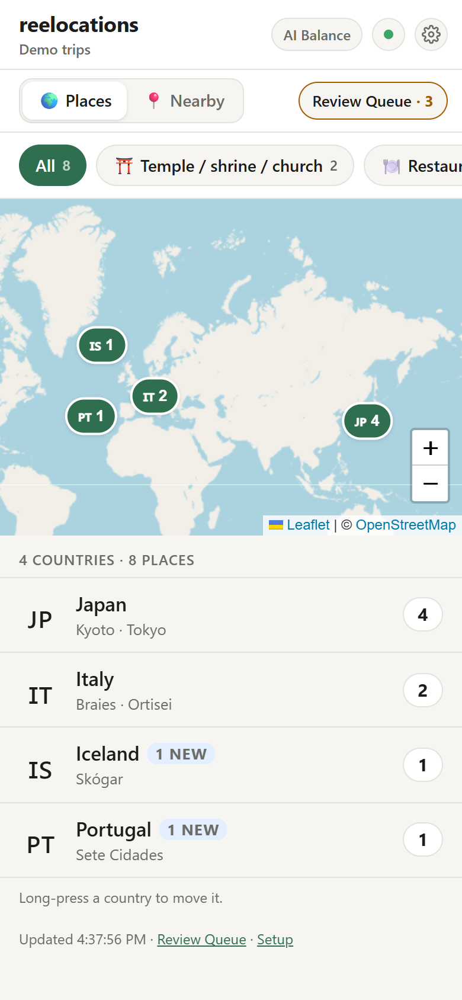
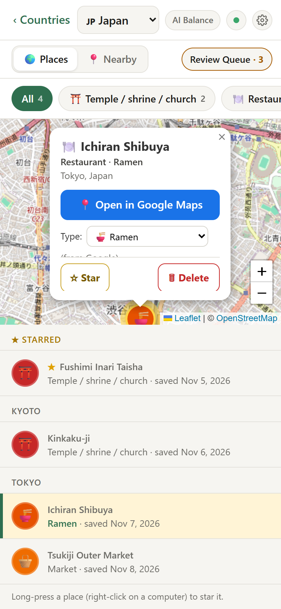
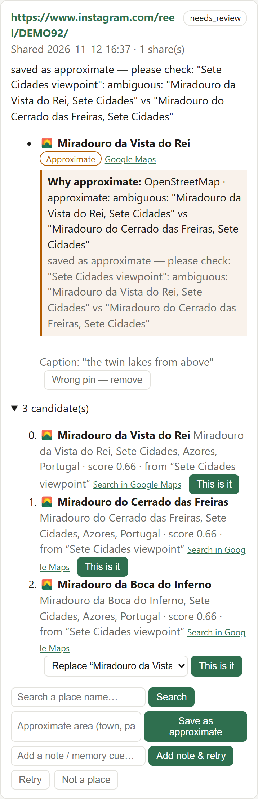
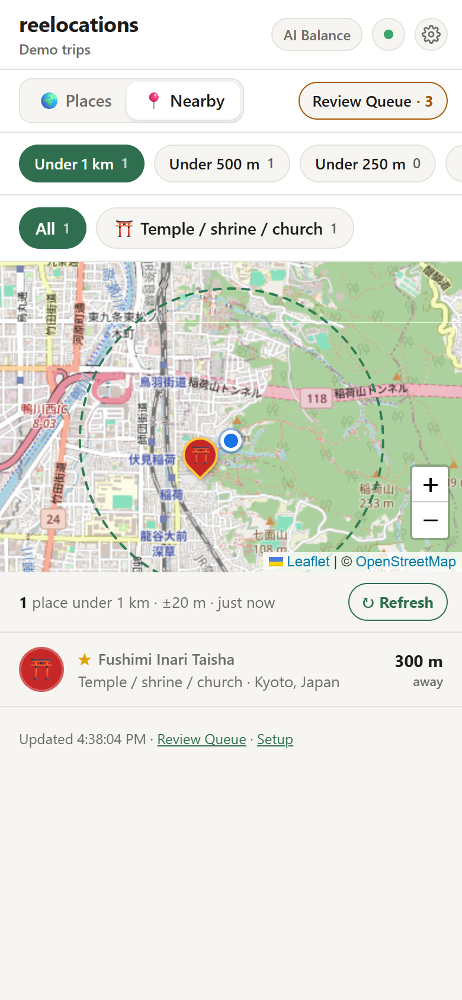
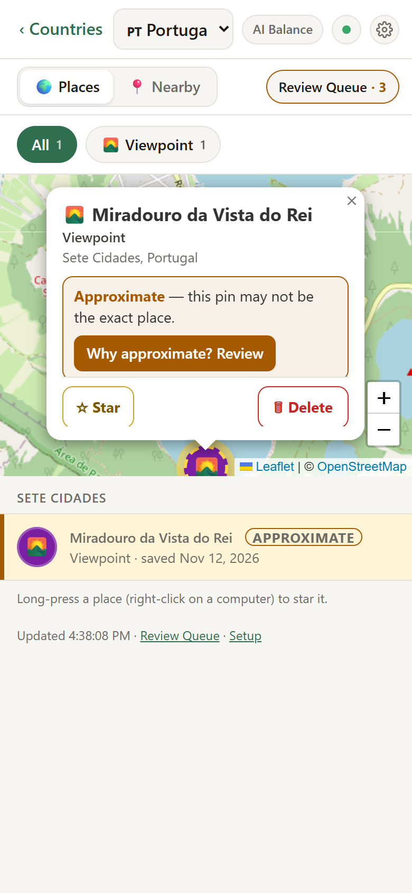
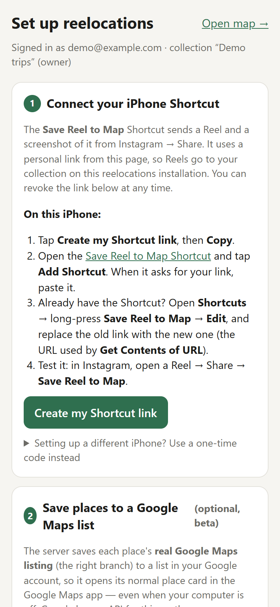
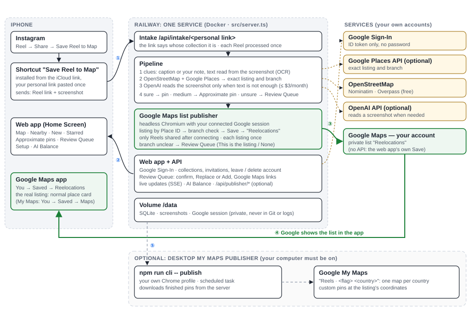

# reelocations

[](https://github.com/Omri1227/reelocations/actions/workflows/ci.yml)
[](LICENSE)


**Share an Instagram Reel from your iPhone; a minute later the place it shows is a pin on your own map and a saved
place in the Google Maps app.**

<p>
  
  
  
</p>

Travel and food Reels name places in captions, on-screen text or speech — and then they are lost in a "Saved" folder
with no map. reelocations turns each shared Reel into the exact Google Maps listing (the right branch of a chain
included), grouped by country and city, with the Reel link and a quote that reminds you why you saved it.

reelocations is **self-hosted**: each installer runs their own server (Railway or any Docker host), creates their own
Google and OpenAI credentials, and each person generates their own personal Shortcut link on that installation.
Nothing is shared with the authors or with other installations.

- Share a Reel with the **Save Reel to Map** Shortcut. It sends the Reel link and a screenshot of the Reel.
- The server works out which place(s) the Reel shows — caption, on-screen text, speech and, within a hard US$3/month
  cap, an AI fallback — finds the exact Google Maps listing (right branch included) and saves a pin with the Reel link,
  the date and a short quote that reminds you why you saved it.
- Anything it is not sure about waits in the **Review Queue**. Medium-confidence matches are saved as **Approximate**
  pins (marked in the list) and keep their Review Queue entry, which explains why and offers the alternatives, each
  with a Google Maps link.
- The web app shows your places by country, with type and restaurant-subtype filters, **Nearby** (saved places within
  1 km … 100 m of your phone), **New** and **Starred** places, and shared collections for 2–3 people.
- Google Maps: the server can save each verified place's **real listing** to a list in your Google account
  (*Reelocations*, beta), and a desktop publisher can keep one Google My Map per country. See
  [Google Maps](#google-maps).

## Engineering notes

What is interesting in this codebase, with the file to read for each:

- **A cost-ordered pipeline.** Each Reel goes through the cheapest method that can settle it: caption and note text →
  on-device OCR of the screenshot → speech → and only then a paid AI call, inside a hard US$3/month cap. Every paid
  answer is stored and replayed, so re-processing costs nothing. (`src/pipeline.ts`, `src/budget.ts`)
- **The AI is never trusted on its own.** A model suggestion is a *clue*; it becomes a pin only when OpenStreetMap or
  Google Places confirms the name inside the stated city or country. The outcome has three levels — **pin**,
  **Approximate pin** (saved, but still asked about) and **Review Queue** — so a wrong guess is visible instead of
  silent. (`src/resolve/resolver.ts`)
- **The right branch, not just the right chain.** Pins carry a Google Place ID. Before a listing is saved to Google
  Maps, the place card's name and address are compared with the pin (house numbers, street words, postal codes are
  not house numbers). A mismatch is held back and asked in the Review Queue. (`src/geo/googleMatch.ts`,
  `src/sync/savedList.ts`)
- **Writing to Google Maps without an API.** Google has no API for saved lists, so the server drives Google Maps' own
  web UI in headless Chromium with the user's session: a queue with back-off, one save per listing, a "fresh start"
  date so old places are never bulk-saved, and a visible *needs sign-in* state. (`src/sync/savedListRunner.ts`)
- **Quality is measured, not asserted.** A labelled set of real Reels plus written fixtures, a holdout split fixed by
  hash before tuning, and a harness that replays the real pipeline against cached lookups (deterministic, US$0).
  Current numbers: **95.7 %** exact place and branch, **97.9 %** pin precision; the last round cut needless reviews
  from 19 % to 14 % of Reels with no change in accuracy. (`scripts/eval-quality.ts`, [docs/QUALITY-RESEARCH.md](docs/QUALITY-RESEARCH.md))
- **A small stack on purpose.** Node 24 runs the TypeScript sources directly (no build step), SQLite through
  `node:sqlite`, four runtime dependencies, a single-file web app without a framework, live updates over SSE.
- **Several people, isolated.** Google Sign-In, collections with invitations, hashed and revocable credentials, a
  membership check on every route, and tests for isolation, leaving and account deletion. (`src/accounts.ts`,
  `test/accounts.test.ts`)
- **106 tests, all offline.** Recorded OpenStreetMap answers, a fake Google sign-in, a fake My Maps and a fake Google
  Maps list; `test/regressions.test.ts` holds one test per bug found in review.

## Screenshots

From `npm run demo` (synthetic data) in iPhone-size Chrome; regenerate with `node scripts/screenshots.ts "<demo link>"`.

| Places by country | A place | Nearby |
|---|---|---|
|  |  |  |
| **Approximate pin** | **Review Queue** | **Setup** |
|  |  |  |

## How the pieces fit



The full flow and every credential: [docs/reelocations-architecture.pdf](docs/reelocations-architecture.pdf)
(source: `docs/architecture.html`; the diagram above is `docs/architecture.svg`).

## Quick start (local, no accounts or keys)

Requirements: **Node.js ≥ 24** (it runs the TypeScript sources directly). Google Chrome is needed only for the browser
checks and the Google Maps publishers.

```bash
npm install
npm test          # offline (recorded OSM answers, fake Google sign-in, fake My Maps, fake Google Maps list)
npm run demo      # server with SYNTHETIC data → open the printed http://127.0.0.1:8090/auth/dev?t=… link
```

The demo creates `data/demo/` with well-known public places in four countries, three Reels in the Review Queue (one
with an Approximate pin), one starred place and New places, and signs you in as "Demo User" through a link that exists only in demo mode. Map tiles
come from openstreetmap.org when you are online.

Other entry points:

| Command | What it does |
|---|---|
| `npm start` | the server (`src/server.ts`); needs `APP_TOKEN`, and `GOOGLE_OAUTH_CLIENT_ID` for sign-in |
| `npm run cli -- gmaps-connect <server URL> <code>` | sign in to Google in a Chrome window and give your server that session for the Google Maps list (code from Setup) |
| `npm run cli -- connect <server URL> <code>` | pair this computer as a My Maps publisher (code from Setup) |
| `npm run cli -- publish [--test-map] [--watch]` | publish finished pins to My Maps (`--test-map`: disposable maps) |
| `npm run typecheck` | `tsc` (type checking only; Node runs the sources) |
| `npm run eval:quality -- --only fixtures` | result-quality evaluation on the written captions in `test/eval/` |
| `npm run railway:plan` | `railway config plan` for `.railway/railway.ts` (works on Windows too) |
| `npm run smoke` | the original desktop-only pipeline end to end (Apps Script emulator, offline) |

## Configuration and credentials

Copy `.env.example` to `.env` (local) or set the same variables in your host's dashboard (Railway → Variables); every
variable is documented there. None is needed for `npm test` or `npm run demo`. You create every credential yourself:

| Credential | Required? | Who creates it, where | What it enables | Without it |
|---|---|---|---|---|
| `APP_TOKEN` | **required** | the installer generates a random secret (≥16 chars) | the admin API (backup, import, probes) | the server does not start |
| `GOOGLE_OAUTH_CLIENT_ID` | **required for real use** | the installer: Google Cloud Console → OAuth client ID, type *Web application*, origin = your site. No client secret | Google Sign-In: accounts and collections | the server runs, but nobody can sign in (the demo still works) |
| `GOOGLE_PLACES_API_KEY` | optional (recommended) | the installer: Google Cloud, *Places API (New)*, billing enabled; the app keeps to a monthly call cap | the exact Google listing and branch for each pin | OpenStreetMap only; pins open by coordinates; the Google Maps list has nothing to save |
| `OPENAI_API_KEY` | optional | the installer: platform.openai.com, prepaid credit | reading screenshots/video frames when the text is not enough (hard cap US$3/month) | those Reels go to the Review Queue |
| Personal Shortcut link | **required per person** | each user: Setup → *Create my Shortcut link* | saving Reels to their collection | — |
| Google Maps session (beta) | optional | each collection owner: Setup → *Create Google Maps code* → `npm run cli -- gmaps-connect` | the server saves real listings to their Google Maps list | — |
| My Maps publisher token | optional | each user: Setup → *Create desktop code* → `npm run cli -- connect` | one My Map per country, from their computer | — |
| `INBOX_URL` / `INBOX_TOKEN`, `ANTHROPIC_API_KEY` | legacy | — | the original Apps Script inbox / old vision fallback ([docs/legacy-apps-script.md](docs/legacy-apps-script.md)) | not needed for new installs |

`@huggingface/transformers` (an optional npm dependency) adds local speech-to-text; without it there is no transcript.

## Install Save Reel to Map on iPhone

You need a reelocations installation first (yours, or one whose owner invited you). The link in step 1 is generated by
**that installation** for **you**.

1. Sign in to reelocations with Google, open **Setup** and tap **Create my Shortcut link**, then **Copy**. This link is
   personal: it saves Reels into your own collection, so don't share it.
2. On the iPhone, open this iCloud link and tap **Add Shortcut**:
   <https://www.icloud.com/shortcuts/1659842abe2140589bfec5d68e95a159>
3. When the Shortcut asks for your link during setup, paste the link you copied in step 1.
4. Test it: in Instagram open a Reel → Share → **Share to…** → *Save Reel to Map*. The pin appears on your map within
   about a minute.

The Shortcut sends the Reel link and a screenshot of the Reel (it takes the screenshot itself). Tip: tap **more** on
the Reel's description before sharing, so the screenshot contains the whole text. If the Shortcut doesn't appear in
Instagram's share sheet, see [docs/legacy-apps-script.md](docs/legacy-apps-script.md#shortcut-a-save-reel-to-map-share-sheet).
To change the link later (for example after revoking it in Setup), edit the Shortcut and replace the old link.

## Using it

1. **Sign up** with Google on the website, then install the Shortcut as described above. In Instagram: Share →
   *Save Reel to Map*.
2. Open the website: countries → places → details (Open in Google Maps, the Reel, a screenshot, Delete). A country
   shows **N new** while it has places you have not opened yet; the gear button opens Setup.
   **Swipe left** to delete, **long-press** to star, **Nearby** for what is around you, **Review Queue** for undecided
   Reels. An **Approximate** pin has a *Why approximate? Review* button that opens its own Review Queue entry.
   In the Review Queue, an option for a Reel that already has a pin comes with **Replace “…”** (pre-selected: the pin it
   most likely stands for) or **Add as another place**; a replaced pin stays gone when the Reel is re-processed.
3. To share a collection, the owner creates an invitation link in Setup; each person signs in with their own Google
   account and connects their own Shortcut. Members can **leave** a collection (the places they added stay); anyone can
   **delete their account** in Setup.
4. **AI Balance** (installation owner only): enter your OpenAI credit balance; the panel estimates how many Reels the
   AI fallback can still read.

## Google Maps

Google offers **no API** to write to a user's saved lists or to My Maps, so both options drive Google Maps' own web UI
in a browser signed in to **your** Google account. The website's Google Sign-In never grants this access.

- **Google Maps list on the server (beta).** Setup → *Create Google Maps code*, then on a computer with Chrome:
  `npm run cli -- gmaps-connect https://<your-app> <code>`. Sign in in the window that opens (use a dedicated test
  account first). Only the resulting browser session is sent to your server and kept in `/data/private/gmaps/` (never
  in Git or logs). Only Reels you share **after the first connection** are saved (a fresh start: earlier places are left out). The server
  opens each pin's listing **by Place ID**, checks the name and branch (address
  numbers), and uses **Save → Reelocations**. Only verified listings are saved; approximate, ambiguous or unmatched
  pins stay in the Review Queue. A save the branch check holds back also appears in the Review Queue: *This is the
  listing* saves it, *None of these* keeps it out. Each listing is saved once; Setup shows saved / pending / failed /
  needs review and **needs sign-in** when the session expires. Verified end to end on 2026-11-12 (Railway, test
  account, six Reels, the list and place cards checked on an iPhone) — see [docs/HOSTED.md](docs/HOSTED.md#google-maps-list-beta).
- **My Maps per country (desktop).** Setup → *Create desktop code* → `npm run cli -- connect <server URL> <code>`,
  rehearse with `publish --test-map`, then set `MYMAPS_REAL_SYNC=true`. `npm run install-task` adds a Windows task
  that runs every 15 minutes; with `WORKER_MODE=sync-only` it only publishes. These are custom pins (not the business
  listing) and need the computer on.

## Deploying (Railway)

`Dockerfile` + `.railway/railway.ts` (the only Railway configuration: one service, a volume mounted at `/data`, health
check `/healthz`). Set the variables from `.env.example` in the Railway dashboard (`APP_TOKEN`,
`GOOGLE_OAUTH_CLIENT_ID`, `PUBLIC_URL`, optional provider keys), check with `npm run railway:plan`, then `railway up`.
Details and operations: [docs/HOSTED.md](docs/HOSTED.md).

## Tests and checks

- `npm test` — 106 tests, offline: unit, pipeline scenarios, hosted server (accounts, isolation, sharing, leaving, account deletion,
  per-collection listing choices, approximate pins, Nearby/New/Star APIs), My Maps grouping with a fake My Maps, the
  Google Maps list queue and branch check, and one regression test per bug found in review. The same tests and the
  type check run on every push (`.github/workflows/ci.yml`).
- Browser checks in Chrome's iPhone emulation, against a **local copy** of a database:
  `node scripts/local-ui-server.ts <copy>/reel-maps.sqlite 18791`, then `scripts/verify-ui.ts` and
  `scripts/verify-features.ts`.
- Result quality: [docs/QUALITY-RESEARCH.md](docs/QUALITY-RESEARCH.md) (method, targets, before/after numbers).
- Re-processing existing pins with new rules: `node scripts/reprocess-dryrun.ts --db <copy>` lists proposed changes
  (dry run; nothing is changed).
- What has been verified on a real iPhone, in My Maps and in the Google Maps app:
  [docs/HOSTED.md](docs/HOSTED.md#what-is-verified-where).

## Privacy

- Google passwords are never seen; sessions and credentials are stored only as hashes.
- Every collection is checked on the server for each API call, screenshot and live-update stream.
- Nearby uses the phone's location only inside the page; it is never sent or stored.
- Provider keys stay on the server. A Google Maps list session stays in the server's private storage.
- Leaving a collection ends access at once; deleting an account removes the account, its sign-ins, links, stars and
  solely owned collections; places added to shared collections stay there without the person's name.
- Local data (`data/`), `.env`, Chrome profiles and personal evaluation data (`private/`) are git-ignored.

## Repository layout

```
src/server.ts        hosted app (HTTP, accounts, intake, web, publisher API)    src/cli.ts       desktop commands
src/pipeline.ts      one Reel end to end                                        src/resolve/     place resolution
src/extract/         clue extraction from caption/OCR/speech                    src/geo/         OSM, Google Places, listing match
src/media/           OCR, frames, speech, OpenAI/vision fallbacks (budgeted)    src/sync/        My Maps + Google Maps list publishers
src/web/             map.html (web app), landing, setup, icons                  src/accounts.ts  sign-in, collections, credentials
test/                node:test suites + recorded fixtures                       scripts/         demo, eval, dry run, browser checks
docs/                HOSTED (current), QUALITY-RESEARCH, architecture (PDF, HTML, SVG), screenshots, legacy setup
```

## License

[MIT](LICENSE).
